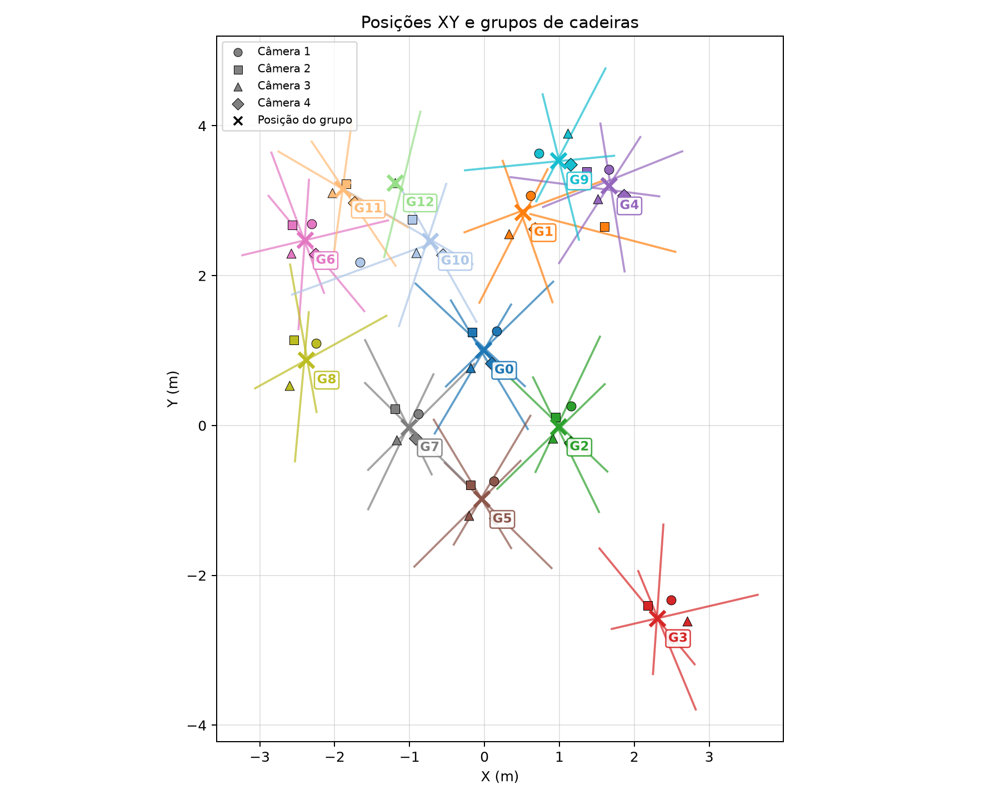

# Localização de objetos com quatro câmeras

Este projeto estima a posição de cadeiras no plano do chão a partir de imagens sintéticas de quatro câmeras calibradas. O detector YOLO produz caixas delimitadoras; o programa principal projeta cada detecção no plano `Z = 0`, associa observações da mesma cadeira entre câmeras e mostra os resultados em gráficos. A saída é uma posição **XY estimada**, não uma reconstrução 3D da geometria de cada cadeira.

## Arquivos do projeto

| Caminho | Função |
| --- | --- |
| `get_annotations.py` | Executa o YOLO nas quatro imagens e grava as detecções em JSON. |
| `main.py` | Converte detecções em coordenadas do mundo, associa cadeiras entre câmeras, imprime grupos e abre as visualizações. |
| `utils.py` | Define os caminhos dos dados; aceita variáveis de ambiente para substituir os padrões. |
| `data/images/camera_1.png` … `camera_4.png` | Imagens sintéticas de entrada, com 1280 × 720 pixels. |
| `data/calibration/calib_rt1.npz` … `calib_rt4.npz` | Parâmetros de calibração correspondentes a cada câmera. |
| `annotations/camera_1.json` … `camera_4.json` | Detecções geradas localmente; esta pasta não é enviada ao Git. |
| `yolo26n.pt` | Nome de arquivo de pesos usado por padrão para gerar anotações; o arquivo não é enviado ao Git. |
| `docs/groups_xy.png` | Gráfico XY gerado por `main.py` e exibido neste README. |

O ambiente `.venv/`, arquivos de cache, a pasta `annotations/` e todos os arquivos `*.pt` ficam apenas na máquina local. A imagem em `docs/groups_xy.png` foi gerada com anotações locais produzidas anteriormente com `yolo26x.pt`; ao gerar novas anotações com outro modelo, o resultado pode mudar.

## Preparação

É necessário Python e uma interface gráfica compatível com Qt para abrir as janelas do Matplotlib. O ambiente local usado no desenvolvimento tinha Python 3.14.7, NumPy 2.5.4, OpenCV 5.0.0.93, Matplotlib 3.11.2, PyQt6 6.11.0 e Ultralytics 8.4.180. O arquivo `requirements.txt` lista as dependências diretas, sem travar versões.

```bash
python -m venv .venv
source .venv/bin/activate
python -m pip install -r requirements.txt
```

Para executar a partir de um clone novo, obtenha um arquivo de pesos compatível, coloque-o na raiz do projeto com o nome `yolo26n.pt` ou defina `YOLO_MODEL_PATH` com o caminho do modelo. Gere as anotações antes de rodar `main.py`.

### Caminhos de entrada

Por padrão, os scripts procuram, em relação à raiz deste repositório:

```text
data/calibration/calib_rt1.npz ... calib_rt4.npz
data/images/camera_1.png ... camera_4.png
annotations/camera_1.json ... camera_4.json  # gerados localmente
```

Para usar outros diretórios, defina `CALIB_PATH_RAW`, `IMAGES_PATH_RAW` e/ou `ANNOTATIONS_PATH` antes de executar os scripts. `YOLO_MODEL_PATH` escolhe outro arquivo de pesos ao gerar anotações. Exemplo:

```bash
YOLO_MODEL_PATH=./outro_modelo.pt python get_annotations.py
```

Cada `.npz` precisa conter pelo menos `nK` (matriz intrínseca 3 × 3), `rt` (transformação mundo → câmera, 4 × 4) e `rt_inv` (transformação câmera → mundo, 4 × 4), coerentes com a respectiva imagem. Os arquivos incluídos também têm outros campos de calibração, que estes scripts não leem.

## Execução

Em um clone novo, depois de disponibilizar os pesos, execute:

```bash
python get_annotations.py
python main.py
```

`get_annotations.py` lê as quatro imagens, carrega `yolo26n.pt` por padrão e executa o modelo uma vez por câmera. Para cada caixa detectada, grava classe, confiança e coordenadas `(x1, y1, x2, y2)` em `annotations/camera_N.json`. Os JSONs existentes são **substituídos** a cada execução. O detector usa os parâmetros padrão da biblioteca Ultralytics; o script não aplica filtros próprios de confiança ou classe. A função `load_cameras_params()` existe nesse arquivo, mas não é chamada no fluxo atual.

Se você já tiver os JSONs na pasta local `annotations/`, pode executar apenas `python main.py`; esse script não carrega os pesos YOLO.

Cada JSON tem metadados (`camera_id`, `image`, `width`, `height`, `num_objects`) e uma lista `annotations`. Cada item da lista segue este formato:

```json
{
  "id": 0,
  "class_id": 56,
  "class_name": "chair",
  "confidence": 0.8081,
  "bbox": {"x1": 606.81, "y1": 277.17, "x2": 680.08, "y2": 390.21}
}
```

## Como `main.py` calcula as posições

1. Carrega as quatro calibrações e os quatro JSONs e cria uma representação para cada detecção, independentemente da classe.
2. Usa o ponto no **centro da borda inferior** da caixa (`u = (x1+x2)/2`, `v = y2`) como aproximação do contato do objeto com o chão. Com `nK⁻¹` e `rt_inv`, transforma esse pixel em um raio no mundo e o intersecta com `Z = 0` para obter um ponto XY por detecção.
3. Projeta a direção vertical do mundo na imagem usando `nK` e a rotação de `rt`. A reta que passa pelo centro da caixa e por esse ponto de fuga vira uma reta no plano XY pela homografia do chão `H = nK [r₁ r₂ t]`. Essas retas auxiliam a associação entre câmeras.
4. Mantém só detecções cuja `class_name` é exatamente `chair`. Calcula a matriz de distâncias euclidianas entre seus pontos XY.
5. Para cada par de cadeiras visto por **câmeras diferentes**, calcula a interseção das retas no chão. Descarta pares com ângulo menor que 12° ou cuja interseção fique a mais de 1,2 m de qualquer um dos dois pontos XY. Os pares restantes são ordenados pelo custo (soma desses dois desvios).
6. Une grupos em ordem de custo somente quando não repetem câmera, todos os pares do grupo proposto têm interseção válida e cada interseção fica a até 0,5 m da mediana das interseções do grupo. Detecções sem par válido permanecem em grupos unitários.
7. Para grupos com duas ou mais detecções, estima o XY final por mínimos quadrados sobre as retas do grupo. Para grupos unitários, mantém o XY da própria detecção.

O terminal mostra o número de detecções de cadeiras, o número de grupos e, para cada grupo, os índices das detecções, câmeras envolvidas e posição XY arredondada. Os índices se referem à lista de cadeiras criada em `main.py`; eles **não** são os IDs locais de cada JSON.

Com os JSONs usados para gerar a figura deste README, a execução imprimiu **46 detecções de cadeiras e 13 grupos**. Esses números podem mudar após gerar novas anotações ou trocar as imagens/modelo.

As janelas gráficas exibem: (1) pontos XY por detecção, retas projetadas e posições de **todos** os grupos; (2) a matriz de distâncias em metros; e (3) as quatro imagens com caixas e eixos verticais **somente das cadeiras**. Cada grupo `G0`, `G1` etc. recebe a mesma cor no gráfico e nas imagens; o formato do ponto XY identifica a câmera. `main.py` salva a figura XY em `docs/groups_xy.png` a cada execução. As janelas usam o backend `QtAgg` e exigem uma sessão gráfica.



Em um servidor sem interface gráfica, `MPLBACKEND=Agg python main.py` calcula os grupos e atualiza `docs/groups_xy.png` sem abrir janelas.

## Premissas e limites atuais

- O plano de referência é `Z = 0` e a calibração deve estar no mesmo sistema de coordenadas das imagens. O eixo dos gráficos é rotulado em metros conforme a escala dessa calibração.
- O centro inferior da caixa é apenas uma aproximação do ponto de contato com o chão; oclusões, caixas imprecisas ou objetos elevados podem deslocar a posição estimada.
- A associação usa somente geometria; não compara aparência, rastreamento ou confiança do detector. Os limiares acima estão fixos na chamada de `group_objects()` dentro de `main.py`.
- O programa não valida todos os casos geométricos degenerados. Calibração incompatível, raio quase paralelo ao chão ou eixo vertical degenerado pode produzir erro ou resultado incorreto.
- `main.py` exige os quatro arquivos de calibração e os quatro JSONs. Imagens ausentes são omitidas da janela de imagens, mas o cálculo XY ainda usa as anotações e calibrações.
- O gráfico XY é salvo como PNG, mas não há exportação automática da lista de posições ou grupos para um arquivo de dados.
